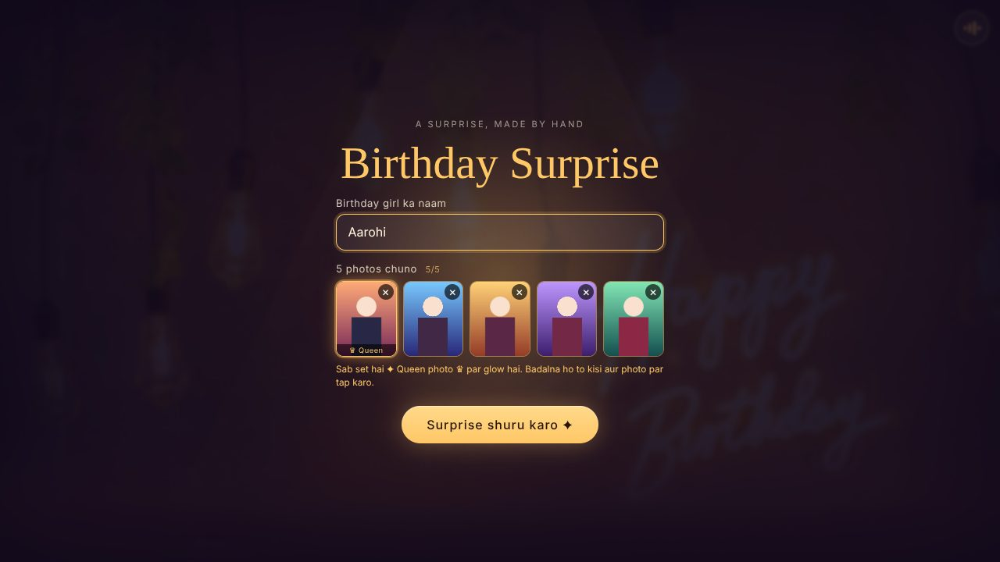
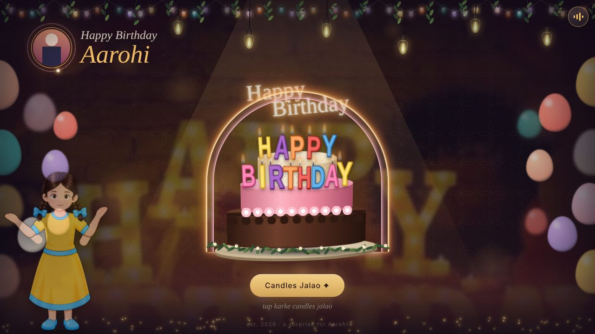
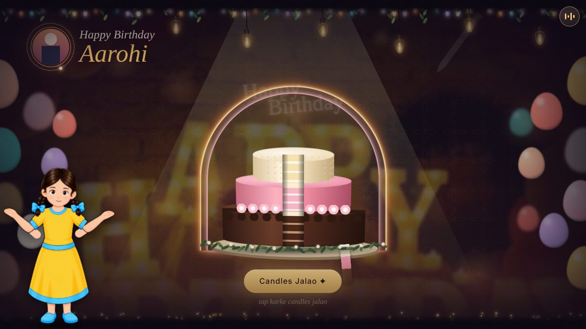
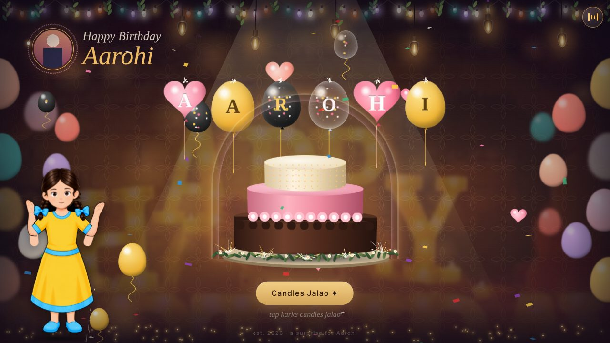
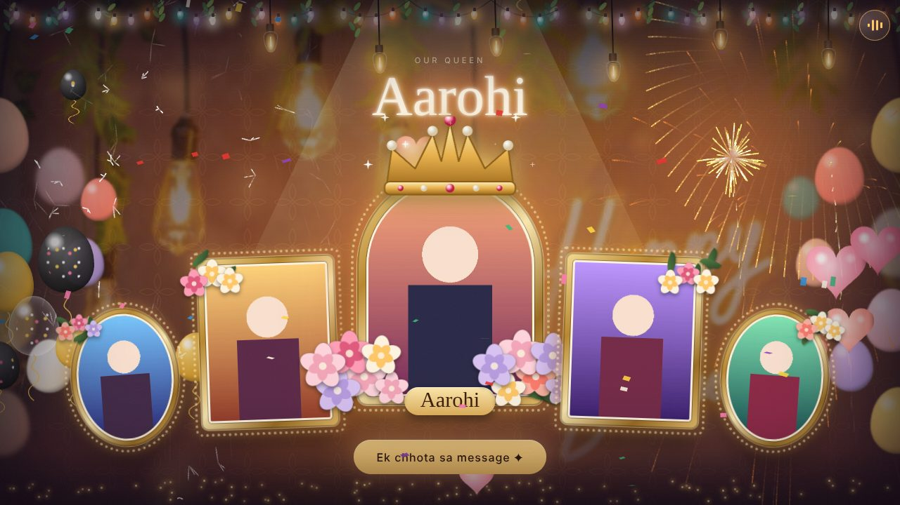

# Birthday Surprise

A cinematic, interactive birthday web experience built with **plain HTML, CSS and JavaScript** (no framework,
no build step, no dependencies). Enter a name and five photos, then light the candles, make a wish, blow them
out, watch an animated character hand over the knife, cut the cake in slow motion, enjoy fireworks, a balloon
name and a photo gallery with a crowned "Queen" frame, and finish with a long heartfelt message.

| Setup | Cake and character | Slow-motion cut |
|---|---|---|
|  |  |  |
| **Fireworks and balloon name** | **Queen gallery** | **Message** |
|  |  |  |

> The screenshots use generated placeholder portraits. Your own photos are shown only in your browser.

## Features

- **Personalised from the first screen** – the name entered appears everywhere (captions, balloons, gallery, message).
  Exactly five photos are required; one of them becomes the Queen photo.
- **3D cake in pure CSS** – three tiers, drips, piped rosettes, sprinkles and wax-letter candles spelling *HAPPY BIRTHDAY*.
- **Interactive sequence** – flying match lights each candle, wind bends the flames, candles lift off, a knife flies in
  and cuts the cake in slow motion (crumbs, cream on the blade, layered interior, slice served on a plate).
- **Rigged 2D character** – layered puppet animation: breathing, blinking, lip movement while she speaks, arm poses,
  head turns, cloth sway, speech bubbles, a farewell walk-off. See [`assets/rig`](assets/rig/README.md).
- **Canvas fireworks** – sparklers, sky shots (peony, ring, willow, crackle, heart), finale volleys and soft glows.
- **Balloons** – the name spells out in a row using hearts, gold, black glitter and clear confetti balloons with curly ribbons.
- **Queen gallery** – crown, ornate frames, flowers, neon title, balloon bunches; photos are resized client-side for sharpness.
- **Music per scene** – crossfaded songs with a now-playing chip, iOS/Android unlock handling and a synthesised fallback.
- **Long glass-card message** – 1000+ words, typewriter effect, auto-scroll and a "show all" button.
- **Responsive and polite** – mobile-first layout, safe-area insets, `prefers-reduced-motion` support, privacy-friendly
  (photos never leave the browser).

> New to GitHub or web projects? Follow the step-by-step [Setup guide](docs/SETUP_GUIDE.md).

## Quick start

Requirements: a modern browser and any static file server. There is nothing to install or build.

```bash
git clone https://github.com/<your-user>/<your-repo>.git
cd <your-repo>

# pick one
python3 -m http.server 8000      # Python
npx serve .                      # Node
# or use the "Live Server" extension in VS Code
```

Open `http://localhost:8000`. Double-clicking `index.html` also works, but audio and web fonts are more reliable over HTTP.

A shareable link can pre-fill the form: `index.html?name=Aarohi&from=Rahul`.

## Project structure

```
.
├── index.html              Page markup (setup form, stage, gallery, message, character rig)
├── style.css               All styling and animations
├── script.index.js         All behaviour: CONFIG, audio, cake, knife, fireworks, balloons, gallery, character
├── assets/
│   ├── audio/              Your songs (not committed) – see assets/audio/README.md
│   ├── bg/                 Placeholder background photos – see assets/bg/README.md
│   └── rig/                Character layers (PNG) – see assets/rig/README.md
├── og.jpg                  Link-preview image (1200 × 630)
├── tools/make_rig.py       Splits a flat character illustration into the animation layers
├── tools/set_site_url.py   Points the Open Graph tags at your real address
├── tools/check_og.py       Validates the link-preview setup
├── docs/screenshots/       Images used in this README
├── .github/workflows/      GitHub Pages deployment
├── LICENSE
└── README.md
```

## Configuration

Everything you are likely to change is in the `CONFIG` object at the top of `script.index.js`.

| Key | Description |
|---|---|
| `message` | Paragraphs of the final message. `{name}` is replaced with the entered name. |
| `from`, `defaultFrom` | Signature name (`from` also accepted as `?from=` in the URL). |
| `pace` | Global speed factor. `1` = fast, `1.3` = calm (default), `1.6` = very slow. Scales every pause and animation. |
| `charDelay` | Typewriter speed in milliseconds per letter. |
| `timing` | How long balloons float / hold. |
| `colors`, `sparkColors` | Colours used for balloons and fireworks. |
| `lightLabel`, `buttonLabel`, `cutLabel` (+ `*Hint`) | Texts of the three action buttons. |
| `audio` | Songs per scene: file name, title, volume, loop. |

Other tweaks: design tokens are CSS variables at the top of `style.css`; balloon styles live in the `BT` object;
the character's lines are the `Avatar.say(...)` calls in the timeline at the bottom of `script.index.js`.

## Songs

Add your own files to `assets/audio/` (they are git-ignored). Default names: `ambient`, `channa-ve`,
`je-tu-meri-jaan`, `happy-birthday`, `tainu-khabar-nahi` (`.mp3`, `.m4a`, `.opus`, `.ogg` or `.wav`).
See [`assets/audio/README.md`](assets/audio/README.md) for the scene mapping. Missing files fall back to a
synthesised tune.

## Link preview (Open Graph)

When the link is shared on WhatsApp, Facebook, Telegram, LinkedIn or Slack, it shows a card with an image, title and
description. The tags are already in the `<head>` of `index.html`, and the preview image is `og.jpg` (1200 × 630 px, ~100 KB).

1. After you know your public address, run  
   `python tools/set_site_url.py https://<your-user>.github.io/<your-repo>/`  
   (it sets `og:url` and `og:image`; both **must be absolute `https://` URLs**).
2. Verify with `python tools/check_og.py` (checks tag names, URL format, title < 40 and description < 100 characters,
   image size and weight).
3. If the old preview keeps showing, bypass the cache: share `https://.../?v=2`, re-run the helper with `--version 2`
   (image becomes `og.jpg?v=2`), or use the [Facebook Sharing Debugger](https://developers.facebook.com/tools/debug/)
   and press **Scrape Again**.

To change the text, edit `og:title` (keep it around 40 characters) and `og:description` (under 100) in `index.html`.

## Deploy to GitHub Pages

1. Push the repository to GitHub (default branch `main`).
2. The included workflow (`.github/workflows/pages.yml`) enables GitHub Pages and publishes the site on every push.
   If the first run reports that Pages is not enabled, open **Settings → Pages** and set **Source** to **GitHub Actions**.
3. Your site is available at `https://<your-user>.github.io/<your-repo>/`.

Alternatively choose **Deploy from a branch → main → / (root)**; the `.nojekyll` file is already present.

Before publishing, read the licensing notes below (songs, background photos and character art).

## Browser support

Current Chrome, Edge, Firefox and Safari (desktop and mobile). Requires the Web Animations API, CSS `clip-path`,
`backdrop-filter`, `:is()` and `createImageBitmap`. On iOS the first tap (the start button) unlocks audio.

## Performance

The fireworks canvas caps its particle count (650 on mobile, 1300 on desktop; `FX.cap`). Large uploaded photos are
downscaled to 1600 px before use. If an older phone stutters, lower `FX.cap` or raise `CONFIG.pace`.

## Accessibility

Semantic landmarks and ARIA live regions for the message and subtitles, visible focus styles, keyboard-operable
cake (Enter / Space), and `prefers-reduced-motion` support that disables the heavy motion.

## Troubleshooting

| Problem | Fix |
|---|---|
| No music | Check the file names in `assets/audio/`, the mute button (top right) and the phone's silent switch. `.opus` does not play on iOS; use `.mp3`. |
| Background photos missing | Restore `assets/bg/*.jpg` or replace them; the page works without them. |
| Start button disabled | A name and exactly five images are required. |
| Choppy animation | Lower `FX.cap`, raise `CONFIG.pace`, close other heavy tabs. |
| Something looks broken | Open the browser console (F12) and open an issue with the error and a screenshot. |

## Licensing and credits

- **Code** (HTML, CSS, JavaScript, `tools/make_rig.py`): MIT, see [`LICENSE`](LICENSE).
- **Songs**: not included. Use only music you are permitted to use.
- **Background photos** (`assets/bg`): placeholders gathered from the web. Replace or remove them unless you own the rights.
- **Character artwork** (`assets/rig`): make sure you hold the rights to the illustration you publish.
- **Fonts**: loaded from Google Fonts under the SIL Open Font License (Cormorant Garamond, DM Sans, Pinyon Script,
  Sacramento, Fredoka).
- **Personal data**: photos are processed locally with `blob:` URLs and are never uploaded.

## Contributing

Issues and pull requests are welcome. Keep the project dependency-free; test on a phone-sized and a desktop viewport.
